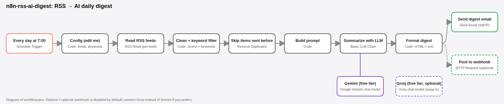

# n8n RSS → AI daily digest (free template)

A free [n8n](https://n8n.io/) workflow. Once a day it reads several RSS or Atom feeds, drops duplicates and items you've already been sent, keeps only items that match your keywords, asks a free-tier LLM to write a short digest, and sends that digest by **email** or to a **webhook** (Slack, Discord, Teams or any URL that takes JSON).

*Diagram of `workflow.json`. Dashed parts are optional.*

| File | What it is |
| --- | --- |
| `workflow.json` | Main template. Uses n8n's built-in RSS Read node; no extra accounts beyond the LLM key and email. |
| `workflow-apify.json` | Optional variant. Feeds come from the Apify actor [`monriah-studio/rss-feed-monitor`](https://apify.com/monriah-studio/rss-feed-monitor), which has built-in change detection. |
| `scripts/build_workflows.py` | Generates both JSON files, if you'd rather edit the code than the JSON. |

## What it costs

- **n8n**: the self-hosted Community Edition is free ([hosting docs](https://docs.n8n.io/deploy/host-n8n)). n8n Cloud also works, but it's a paid plan.
- **LLM**: defaults to **Google Gemini** on the Gemini API free tier (model `gemini-3.1-flash-lite`). You can switch to **Groq**'s free tier (`openai/gpt-oss-120b`). Either way you need **your own free API key**. Free tiers have rate limits, and on Google's free tier your prompts may be used to improve Google's products ([Gemini pricing](https://ai.google.dev/gemini-api/docs/pricing), [Groq rate limits](https://console.groq.com/docs/rate-limits), both checked Oct 24, 2026). One digest a day is a single LLM call, well inside both free tiers.
- **Email**: any SMTP account you already have, e.g. Gmail with an app password, or your host's SMTP.
- **Apify variant only**: the actor is pay-per-result ($1.50 per 1,000 items as of Oct 24, 2026), billed to your own Apify account. Apify's free plan includes monthly platform credit.

## Setup (about 10 minutes)

1. **Run n8n.** For a quick local start: `npx n8n` (n8n 2.x needs Node.js 24+), or use the [Docker instructions](https://docs.n8n.io/deploy/host-n8n). Open http://localhost:5678 and create your local owner account.
2. **Import the workflow.** In n8n: *Workflows → Create → ⋯ menu → Import from file* → pick `workflow.json`. Or from the CLI: `n8n import:workflow --input=workflow.json`.
3. **Edit `Config (edit me)`.** This Code node holds the feed URLs, keywords (whole-word, case-insensitive; empty list = keep everything), `lookbackHours`, item limits, the digest title, and the email and webhook addresses.
4. **Add the LLM key.** Open **Gemini (free tier)** → *Credential* → *Create new* → paste a key from [Google AI Studio](https://aistudio.google.com/apikey) ([n8n docs](https://docs.n8n.io/integrations/builtin/credentials/googleai)).
   *Prefer Groq?* Remove the link between Gemini and **Summarize with LLM**, connect **Groq (free tier, optional)** in its place, and add a key from [console.groq.com/keys](https://console.groq.com/keys) ([n8n docs](https://docs.n8n.io/integrations/builtin/credentials/groq)).
5. **Choose where the digest goes.**
   - Email: open **Send digest email** and add an SMTP credential ([n8n docs](https://docs.n8n.io/integrations/builtin/credentials/send-email)).
   - Webhook: enable **Post to webhook** (it's disabled by default) and set `webhookUrl` in the Config node. It POSTs JSON with `text`, `content` (the first 1,900 characters, for Discord), `subject`, `summary`, `items` and `date`. For Slack, the `text` field is enough. If you only want the webhook, disable the email node.
6. **Test**, then turn it on. Click *Execute workflow*. When the digest looks right, set the workflow to **Active**. The trigger runs every day at 07:00 in your workflow's timezone, which you can change in *Workflow settings → Timezone*.

### How "already sent" works

**Skip items sent before** is n8n's *Remove Duplicates* node in *Remove items processed in previous executions* mode, keyed on each item's link. Every link reaches your inbox once. If nothing new matches, the workflow stops quietly and sends nothing. To start over, run the Remove Duplicates node once in *Clear deduplication history* mode.

### Apify variant

Import `workflow-apify.json` instead. On **Apify: rss-feed-monitor**, create a *Header Auth* credential with name `Authorization` and value `Bearer <your Apify API token>`. The actor's `onlyNewSinceLastRun` change detection replaces the Remove Duplicates node. It's useful for many feeds, or when you want the feed history stored in Apify. Apify also has its own n8n community node if you'd rather use that than the HTTP Request node.

## Nodes used

Tested on n8n **2.44.6** (the latest release on Oct 24, 2026):

| Node | Type | Version |
| --- | --- | --- |
| Schedule Trigger | `n8n-nodes-base.scheduleTrigger` | 1.2 |
| Code | `n8n-nodes-base.code` | 2 |
| RSS Read | `n8n-nodes-base.rssFeedRead` | 1.2 |
| Remove Duplicates | `n8n-nodes-base.removeDuplicates` | 2 |
| Basic LLM Chain | `@n8n/n8n-nodes-langchain.chainLlm` | 1.7 |
| Google Gemini Chat Model | `@n8n/n8n-nodes-langchain.lmChatGoogleGemini` | 1.2 |
| Groq Chat Model | `@n8n/n8n-nodes-langchain.lmChatGroq` | 1 |
| Send Email | `n8n-nodes-base.emailSend` | 2.1 |
| HTTP Request | `n8n-nodes-base.httpRequest` | 4.2 |

All of these are built-in nodes; no community nodes are needed.

## Licensing

- This template (the JSON and scripts) is **MIT licensed**. Use it, change it, share it or sell it.
- n8n itself is under the [Sustainable Use License](https://docs.n8n.io/n8n-community-license/community-license/license-faq). Running this workflow for yourself or your business on self-hosted n8n is free. Sharing or selling workflow templates is fine. Hosting n8n as a service for others to build workflows on is not allowed without a commercial agreement with n8n.
- Feed content belongs to its publishers. Only read feeds you're allowed to read, and respect their terms.

## Troubleshooting

- **One feed is down**: the RSS node is set to *continue on error*, so the other feeds still go out.
- **Empty digest or no email**: no new items matched your keywords inside `lookbackHours`. Widen the keywords or raise `lookbackHours`.
- **429 / rate limit from the LLM**: you hit the free tier's limit. Lower `maxItemsInDigest`, or wait until the limit resets.
- **Gemini model not found**: Google renames models often. Pick any current Flash or Flash-Lite model in the Gemini node's model list.

Made by [MonRiah Studio](https://monriah-studio.netlify.app/). Not affiliated with n8n, Google, Groq or Apify.
